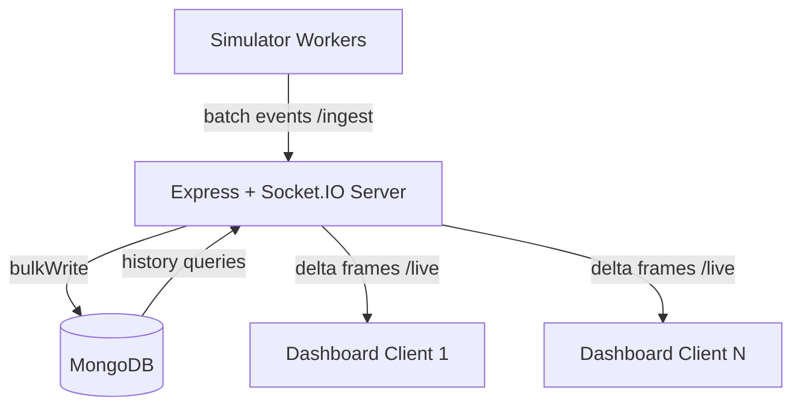

# FleetPulse Implementation Plan

> **For agentic workers:** REQUIRED SUB-SKILL: Use superpowers:subagent-driven-development (recommended) or superpowers:executing-plans to implement this plan task-by-task. Steps use checkbox (`- [ ]`) syntax for tracking.

**Goal:** Build FleetPulse — a real-time mission-control platform for a simulated city-scale electric bus fleet that ingests high-frequency telemetry, stores it idempotently, fans out delta frames via Socket.IO rooms, and provides an operator dashboard with live charts, map, anomaly alerts, Chaos Console, and Time Machine history scrubber.

**Architecture:** Node.js/Express backend with Socket.IO v4 (msgpack), MongoDB (native driver, bulkWrite), and an in-memory state store; React+Vite+TypeScript frontend with MapLibre, uPlot, Zustand, and a single rAF render loop; a Node simulator using worker_threads; shared Zod schemas across packages in an npm workspaces monorepo.

**Tech Stack:** Node.js 20, Express, Socket.IO v4 + socket.io-msgpack-parser, MongoDB native driver, Zod, JWT, bcryptjs, helmet, pino | React 18, Vite, TypeScript strict, Tailwind CSS, Zustand, MapLibre GL JS, uPlot, TanStack Virtual, socket.io-client

**Spec:** `/Users/I041802/Downloads/mernify/MERNIFY_ProblemStatement.pdf` + user message (full FleetPulse spec)

## Global Constraints

- Node.js ≥ 20, TypeScript strict mode on both server and client
- MongoDB native driver (NOT Mongoose) for bulk ops; use Mongoose only if driver is too verbose — spec prefers native
- Socket.IO v4 with `socket.io-msgpack-parser` on both ends
- All simulated data labeled as simulated in README and UI
- PERFORMANCE.md must contain only measured results — no fabricated numbers
- Demo credentials seeded: admin/admin123, operator/operator123, viewer/viewer123
- Every library attributed in README
- `.env.example` committed; never real secrets in repo
- `npm workspaces` monorepo: packages `server`, `simulator`, `client`, `loadtest`, `shared`
- Phase order: 0→1→2→3→4→5→6→7→8→9 — do not start next phase until current passes its "done when" test

## Review Focus

1. **Duplicate events across reconnect boundary** — a client that reconnects mid-stream must not show duplicate data points in charts; the seq-keyed merge must deduplicate correctly even when the history window overlaps buffered live frames.
2. **Out-of-order event state guard** — a late event (lower ts than current state) must update MongoDB/rollups but must NOT overwrite the in-memory state snapshot; verify with a test that sends seq 5 then seq 3 and checks state reflects seq 5 values.
3. **Backpressure under 10× spike** — when the write buffer exceeds HIGH_WATER_MARK, the ack must return `retryAfterMs` and the simulator must back off; the server must not crash or lose events already in the buffer.
4. **JWT expiry on long-running dashboard** — a token that expires while a Socket.IO client is connected must trigger a reconnect+refresh flow, not a silent dead socket; test by setting a 5-second token TTL in tests.
5. **MongoDB E11000 on duplicate seq** — `bulkWrite({ordered:false})` duplicate-key errors must be swallowed and counted as `duplicatesDropped`, not surfaced as unhandled rejections; verify with a test that inserts the same event twice and checks the counter.

---

## File Structure

```
fleetpulse/                          (repo root = /Users/I041802/Downloads/mernify)
├── package.json                     # workspaces: ["server","simulator","client","loadtest","shared"]
├── .env.example
├── docker-compose.yml               # mongo service
├── README.md
│
├── shared/                          # shared types + zod schemas (no runtime deps except zod)
│   ├── package.json
│   └── src/
│       ├── schemas.ts               # TelemetryEvent zod schema + TypeScript types
│       ├── deltaFrame.ts            # DeltaFrame wire type
│       └── index.ts
│
├── server/
│   ├── package.json
│   └── src/
│       ├── index.ts                 # boot: express + socket.io + connect DB + start tick
│       ├── config.ts                # env vars with defaults
│       ├── db.ts                    # MongoDB client + collection getters
│       ├── auth/
│       │   ├── tokens.ts            # signToken, verifyToken
│       │   ├── middleware.ts        # Express JWT middleware
│       │   └── routes.ts            # POST /api/auth/login, /register (seed only)
│       ├── ingest/
│       │   ├── pipeline.ts          # processBatch(events[]) -> IngestResult
│       │   ├── rateLimit.ts         # TokenBucket per device + global in-flight cap
│       │   ├── dedupe.ts            # LRU cache keyed by "deviceId:seq"
│       │   ├── orderGuard.ts        # per-device lastTs map; returns isLate flag
│       │   ├── writeBuffer.ts       # accumulate + flush via setImmediate chunking
│       │   └── ingestNamespace.ts   # Socket.IO /ingest namespace wiring
│       ├── state/
│       │   └── store.ts             # Map<deviceId, BusState>; getState, setState, getAllStates
│       ├── persistence/
│       │   ├── bulkWrite.ts         # flushBuffer(events[]) -> FlushResult (bulkWrite + rollup upsert)
│       │   └── seed.ts              # npm run seed: users + devices + 5 min history
│       ├── anomaly/
│       │   ├── rules.ts             # rule definitions + EWMA/z-score helpers
│       │   └── engine.ts            # evaluateEvent(event, state) -> Alert[]
│       ├── realtime/
│       │   ├── liveNamespace.ts     # Socket.IO /live namespace, rooms, subscribe/unsubscribe
│       │   ├── tick.ts              # 100 ms tick: build delta frames, emit per room
│       │   └── snapshot.ts          # buildSnapshot(deviceIds) -> SnapshotPayload
│       ├── api/
│       │   ├── history.ts           # GET /api/history
│       │   ├── metrics.ts           # GET /api/metrics
│       │   ├── alerts.ts            # GET/PATCH /api/alerts
│       │   └── simControl.ts        # POST /api/sim/chaos
│       └── metrics/
│           └── counters.ts          # rolling counters module (events/s, p95, etc.)
│
├── simulator/
│   ├── package.json
│   └── src/
│       ├── index.ts                 # main: spawn workers, control channel
│       ├── routes.ts                # 6 Bengaluru route polylines (lat/lng arrays)
│       ├── physics.ts               # SoC drain, motor temp model, tyre PSI
│       ├── bus.ts                   # BusAgent: follows route, emits events
│       ├── worker.ts                # worker_thread: runs N buses
│       └── faults.ts                # fault injection handlers (overheat, GPS jump, etc.)
│
├── client/
│   ├── package.json
│   ├── vite.config.ts
│   ├── tsconfig.json
│   └── src/
│       ├── main.tsx
│       ├── App.tsx                  # router + auth guard
│       ├── socket.ts                # socket.io-client singleton, reconnect logic
│       ├── store/
│       │   ├── busStore.ts          # Zustand: Map<deviceId, BusState>, ring buffers
│       │   ├── alertStore.ts        # Zustand: alerts[]
│       │   └── metricsStore.ts      # Zustand: perf metrics
│       ├── raf/
│       │   └── renderLoop.ts        # single rAF loop; flushMap / flushCharts / flushKPIs
│       ├── pages/
│       │   ├── MissionControl.tsx   # map + KPI strip + alert feed
│       │   ├── Analytics.tsx        # rollup charts
│       │   └── Admin.tsx            # Chaos Console + system metrics
│       ├── components/
│       │   ├── Map.tsx              # MapLibre component
│       │   ├── BusDrawer.tsx        # charts + Time Machine
│       │   ├── AlertFeed.tsx
│       │   ├── KpiStrip.tsx
│       │   ├── PerfHud.tsx
│       │   ├── ChaosConsole.tsx
│       │   └── ConnectionPill.tsx
│       └── hooks/
│           ├── useHistory.ts        # fetch + merge history+live, gap backfill
│           └── useTimeMachine.ts    # scrubber state, replay speed, LIVE button
│
├── loadtest/
│   ├── package.json
│   └── src/
│       └── runner.ts                # spawns N device clients + M dashboard clients, outputs markdown
│
└── docs/
    ├── superpowers/plans/           # this file
    ├── ARCHITECTURE.md
    ├── PERFORMANCE.md
    ├── DEMO_SCRIPT.md
    └── JUDGE_QA.md
```

---

## Task 0: Monorepo Scaffold

**Files:**
- Create: `package.json` (root workspaces)
- Create: `shared/package.json`, `shared/src/index.ts`
- Create: `server/package.json`
- Create: `simulator/package.json`
- Create: `client/package.json`
- Create: `loadtest/package.json`
- Create: `.env.example`
- Create: `docker-compose.yml`
- Create: `shared/src/schemas.ts`
- Create: `shared/src/deltaFrame.ts`

**Interfaces:**
- Produces: `TelemetryEvent` type and `telemetryEventSchema` Zod schema; `DeltaFrame` wire type — used by every subsequent task

- [ ] **Step 1: Create root `package.json`**

```json
{
  "name": "fleetpulse",
  "private": true,
  "workspaces": ["shared", "server", "simulator", "client", "loadtest"],
  "scripts": {
    "dev": "concurrently \"npm run dev -w server\" \"npm run dev -w client\" \"npm run dev -w simulator\"",
    "seed": "npm run seed -w server",
    "loadtest": "npm run start -w loadtest"
  }
}
```

- [ ] **Step 2: Create `docker-compose.yml`**

```yaml
services:
  mongo:
    image: mongo:7
    ports: ["27017:27017"]
    volumes: ["mongo_data:/data/db"]
volumes:
  mongo_data:
```

- [ ] **Step 3: Create `.env.example`**

Include: `MONGO_URI`, `JWT_SECRET`, `DEVICE_KEY`, `PORT=3001`, `SIM_BUS_COUNT=200`, `SIM_EVENT_RATE_HZ=2`, `FLUSH_INTERVAL_MS=250`, `TICK_RATE_MS=100`, `HIGH_WATER_MARK=500`, `SIM_EMBEDDED=false`, `CLIENT_URL=http://localhost:5173`

- [ ] **Step 4: Create `shared/src/schemas.ts` with `TelemetryEvent` Zod schema**

Fields (all required unless noted):
- `eventId`: `z.string().uuid()`
- `deviceId`: `z.string().regex(/^BUS-\d{4}$/)`
- `seq`: `z.number().int().nonnegative()`
- `ts`: `z.number().int().positive()` (ms epoch)
- `route`: `z.string().max(10)`
- `lat`: `z.number().min(12.8).max(13.2)` (Bengaluru bounds)
- `lng`: `z.number().min(77.4).max(77.8)`
- `speed`: `z.number().min(0).max(120)`
- `soc`: `z.number().min(0).max(100)`
- `motorTemp`: `z.number().min(-10).max(120)`
- `tyrePsi`: `z.number().min(60).max(160)`
- `load`: `z.number().int().min(0).max(60)`

Export `TelemetryEvent = z.infer<typeof telemetryEventSchema>` and `BatchPayload = z.infer<typeof batchPayloadSchema>` where `batchPayloadSchema` is `z.array(telemetryEventSchema).min(1).max(500)`. Also export `HistoryPoint = { seq: number, ts: number, [metric: string]: number }` for use by history merge logic.

- [ ] **Step 5: Create `shared/src/deltaFrame.ts`**

```typescript
export interface BusFrame {
  la?: number;  // lat 5dp
  ln?: number;  // lng 5dp
  s?: number;   // speed 1dp
  b?: number;   // soc 1dp
  m?: number;   // motorTemp 1dp
  p?: number;   // tyrePsi 1dp
  lo?: number;  // load
  st?: number;  // status 0=ok 1=warn 2=crit 3=offline
}

export interface DeltaFrame {
  t: number;   // server timestamp ms
  f: number;   // frame sequence number
  d: [string, BusFrame, number][];  // [deviceId, changed fields, seq]
}

export interface SnapshotPayload {
  buses: Record<string, BusState>;
  serverSeqCursor: number;
  serverTime: number;
}

export interface BusState {
  deviceId: string;
  route: string;
  lat: number;
  lng: number;
  speed: number;
  soc: number;
  motorTemp: number;
  tyrePsi: number;
  load: number;
  seq: number;
  ts: number;
  status: 0 | 1 | 2 | 3;
  lastSeen: number;
}
```

- [ ] **Step 6: Install root deps and workspace deps**

```bash
cd /Users/I041802/Downloads/mernify
npm install concurrently --save-dev
# shared
cd shared && npm init -y && npm install zod
# server
cd ../server && npm init -y
npm install express socket.io @socket.io/msgpack-parser mongodb jsonwebtoken bcryptjs helmet express-rate-limit pino zod
npm install -D typescript @types/express @types/node @types/jsonwebtoken @types/bcryptjs ts-node nodemon
# simulator
cd ../simulator && npm init -y
npm install socket.io-client uuid
npm install -D typescript @types/node ts-node
# client (Vite scaffold)
cd ../client && npm create vite@latest . -- --template react-ts --yes || true
npm install socket.io-client maplibre-gl uplot zustand @tanstack/react-virtual tailwindcss @tailwindcss/vite
# loadtest
cd ../loadtest && npm init -y
npm install socket.io-client
npm install -D typescript @types/node ts-node
```

- [ ] **Step 7: Write the first failing test (schema validation)**

File: `shared/src/__tests__/schemas.test.ts`
```typescript
import { telemetryEventSchema, batchPayloadSchema } from '../schemas';

test('valid event passes', () => {
  const result = telemetryEventSchema.safeParse({ /* valid event */ });
  expect(result.success).toBe(true);
});
test('lat out of Bengaluru bounds fails', () => {
  const result = telemetryEventSchema.safeParse({ lat: 0, /* rest valid */ });
  expect(result.success).toBe(false);
});
test('batch over 500 fails', () => {
  const big = Array.from({length: 501}, () => validEvent());
  expect(batchPayloadSchema.safeParse(big).success).toBe(false);
});
```

- [ ] **Step 8: Run schema tests — expect PASS**

```bash
cd shared && npx jest --testPathPattern=schemas
```

- [ ] **Step 9: Commit**

```bash
git init && git add . && git commit -m "feat: monorepo scaffold, shared schemas, docker-compose"
```

---

## Task 1: Server Foundation + Ingestion Pipeline

**Files:**
- Create: `server/src/config.ts`
- Create: `server/src/db.ts`
- Create: `server/src/metrics/counters.ts`
- Create: `server/src/ingest/dedupe.ts`
- Create: `server/src/ingest/orderGuard.ts`
- Create: `server/src/ingest/rateLimit.ts`
- Create: `server/src/ingest/writeBuffer.ts`
- Create: `server/src/ingest/pipeline.ts`
- Create: `server/src/state/store.ts`
- Create: `server/src/persistence/bulkWrite.ts`
- Create: `server/src/index.ts`
- Test: `server/src/__tests__/pipeline.test.ts`
- Test: `server/src/__tests__/dedupe.test.ts`
- Test: `server/src/__tests__/orderGuard.test.ts`
- Test: `server/src/__tests__/bulkWrite.test.ts`

**Interfaces:**
- Consumes: `TelemetryEvent` from `shared/src/schemas`
- Produces:
  - `processBatch(events: TelemetryEvent[], deviceKey: string): Promise<IngestResult>` where `IngestResult = { accepted: number, duplicates: number, rejected: number, retryAfterMs?: number }`
  - `getState(deviceId: string): BusState | undefined`
  - `getAllStates(): Map<string, BusState>`

- [ ] **Step 1: Write failing tests for dedupe**

File: `server/src/__tests__/dedupe.test.ts`
```typescript
import { DedupeCache } from '../ingest/dedupe';
test('first event accepted', () => {
  const cache = new DedupeCache(1000);
  expect(cache.isDuplicate('BUS-0001', 1)).toBe(false);
});
test('same event is duplicate', () => {
  const cache = new DedupeCache(1000);
  cache.mark('BUS-0001', 1);
  expect(cache.isDuplicate('BUS-0001', 1)).toBe(true);
});
test('different seq not duplicate', () => {
  const cache = new DedupeCache(1000);
  cache.mark('BUS-0001', 1);
  expect(cache.isDuplicate('BUS-0001', 2)).toBe(false);
});
```

- [ ] **Step 2: Implement `DedupeCache` in `server/src/ingest/dedupe.ts`**

LRU map keyed by `${deviceId}:${seq}`, max size from constructor. `isDuplicate(deviceId, seq): boolean`. `mark(deviceId, seq): void`. Use a `Map` with manual eviction (delete oldest entry when at capacity — track insertion order via Map's guaranteed iteration order).

- [ ] **Step 3: Run dedupe tests — expect PASS**

```bash
cd server && npx jest dedupe
```

- [ ] **Step 4: Write failing tests for orderGuard**

File: `server/src/__tests__/orderGuard.test.ts`
```typescript
import { OrderGuard } from '../ingest/orderGuard';
test('first event is not late', () => {
  const g = new OrderGuard();
  expect(g.check('BUS-0001', 1000)).toBe(false); // isLate = false
});
test('older ts is late', () => {
  const g = new OrderGuard();
  g.advance('BUS-0001', 1000);
  expect(g.check('BUS-0001', 999)).toBe(true);
});
test('newer ts advances and is not late', () => {
  const g = new OrderGuard();
  g.advance('BUS-0001', 1000);
  g.advance('BUS-0001', 1001);
  expect(g.check('BUS-0001', 1002)).toBe(false);
});
```

- [ ] **Step 5: Implement `OrderGuard` in `server/src/ingest/orderGuard.ts`**

`Map<string, number>` of `deviceId -> lastTs`. `check(deviceId, ts): boolean` returns true if ts <= lastTs. `advance(deviceId, ts): void` sets lastTs if ts > current.

- [ ] **Step 6: Run orderGuard tests — expect PASS**

```bash
npx jest orderGuard
```

- [ ] **Step 7: Write failing bulkWrite test (E11000 swallowed)**

File: `server/src/__tests__/bulkWrite.test.ts`
```typescript
// integration test — requires MONGO_URI in env or a local mongo
import { flushBuffer } from '../persistence/bulkWrite';
test('duplicate seq increments duplicatesDropped, does not throw', async () => {
  const event = makeEvent('BUS-0001', 1);
  const r1 = await flushBuffer([event]);
  const r2 = await flushBuffer([event]); // same eventId+seq
  expect(r2.duplicatesDropped).toBeGreaterThanOrEqual(1);
});
```

- [ ] **Step 8: Implement `server/src/config.ts`**

Read from `process.env`: `MONGO_URI`, `JWT_SECRET`, `DEVICE_KEY`, `PORT` (default 3001), `FLUSH_INTERVAL_MS` (250), `TICK_RATE_MS` (100), `HIGH_WATER_MARK` (500), `SIM_EMBEDDED` (false). Export typed config object.

- [ ] **Step 9: Implement `server/src/db.ts`**

`connect(): Promise<void>` — creates `MongoClient`, connects, exports `getDb()`, `getCollection(name)`. Collections created on first access. Ensure indexes on startup: `events`: unique `{deviceId:1, seq:1}`, index `{deviceId:1, ts:1}`, TTL `{createdAt:1}` expireAfterSeconds=86400. `rollups`: unique `{scope:1, key:1, res:1, bucketTs:1}`. `alerts`: `{status:1, createdAt:1}`. `devices`: unique `{deviceId:1}`.

- [ ] **Step 10: Implement `server/src/persistence/bulkWrite.ts`**

`flushBuffer(events: TelemetryEvent[]): Promise<FlushResult>` where `FlushResult = { inserted: number, duplicatesDropped: number, rollupUpserts: number, flushMs: number }`. Use `getCollection('events').bulkWrite(ops, {ordered:false})` and catch `BulkWriteError` — swallow code 11000 errors, increment `duplicatesDropped`. After event writes, upsert rollups for 1s/10s/1m buckets using `$min`/`$max`/`$inc` aggregation: bucket by `Math.floor(ts / bucketMs) * bucketMs`. Cap chunk size at 200 ops per `setImmediate` cycle.

- [ ] **Step 11: Implement `server/src/state/store.ts`**

In-memory `Map<string, BusState>`. Exports: `getState(deviceId)`, `setState(deviceId, partial)` (merges, only if ts > current ts), `getAllStates()`, `deleteState(deviceId)`.

- [ ] **Step 12: Implement `server/src/metrics/counters.ts`**

Rolling 1s window counters using a circular buffer of 60 buckets. Tracks: `eventsIn`, `eventsOut`, `duplicatesDropped`, `outOfOrder`, `rejected`, `throttled`, `connectedClients`. Methods: `inc(counter, n?)`, `rate(counter): number` (per-second over last 5s), `snapshot(): MetricsSnapshot`. Also: `recordLatency(ms)` + `p95Latency(): number` using a 1000-sample reservoir.

- [ ] **Step 13: Implement `server/src/ingest/rateLimit.ts`**

`TokenBucket` class: `constructor(ratePerSec, burstMax)`. `consume(n): { allowed: boolean, retryAfterMs?: number }`. Global bucket (default 50000/s burst 5000) + per-device map (default 50/s burst 500). `checkDevice(deviceId, n): ...`.

- [ ] **Step 14: Implement `server/src/ingest/writeBuffer.ts`**

Accumulates events in an array. `push(events[])`. On push: if `buffer.length >= HIGH_WATER_MARK` set `pressured = true`. `scheduleFlush()` — uses `setInterval(FLUSH_INTERVAL_MS)`. `flush()` calls `flushBuffer`, resets buffer. Export `isPressured(): boolean`, `push()`, `start()`, `stop()`.

- [ ] **Step 15: Implement `server/src/ingest/pipeline.ts`**

`processBatch(events: unknown[], deviceKey: string): Promise<IngestResult>`. Steps in order:
1. Validate `deviceKey` against `config.DEVICE_KEY` (HMAC or simple compare — simple string compare is fine for hackathon, document it)
2. Zod parse each event; collect `rejected` for invalid
3. Rate limit check; if pressured return `{retryAfterMs}`
4. Dedupe filter — `isDuplicate` check, count `duplicates`, `mark` accepted
5. Order guard — `check` for isLate; `advance` for non-late; isLate events still go to buffer (history must be complete) but state is NOT updated for them
6. For non-late events: `setState`; run anomaly engine (Task 5, stub for now)
7. `writeBuffer.push(accepted events)`
8. `counters.inc('eventsIn', accepted)`
9. Return `IngestResult`

- [ ] **Step 16: Write pipeline integration test**

File: `server/src/__tests__/pipeline.test.ts`
```typescript
test('valid batch accepted', async () => {
  const r = await processBatch([validEvent()], validKey);
  expect(r.accepted).toBe(1);
  expect(r.duplicates).toBe(0);
});
test('duplicate rejected by dedupe', async () => {
  const e = validEvent();
  await processBatch([e], validKey);
  const r = await processBatch([e], validKey);
  expect(r.duplicates).toBe(1);
});
test('late event stored but state not overwritten', async () => {
  const newer = {...validEvent(), seq:2, ts:2000};
  const older = {...validEvent(), seq:1, ts:1000, speed:99};
  await processBatch([newer], validKey);
  await processBatch([older], validKey);
  expect(getState('BUS-0001')?.speed).not.toBe(99);
});
test('invalid device key returns rejected', async () => {
  const r = await processBatch([validEvent()], 'badkey');
  expect(r.rejected).toBeGreaterThan(0);
});
```

- [ ] **Step 17: Implement `server/src/index.ts`** (minimal — HTTP server + Socket.IO init)

Boot sequence: `connect()` → start `writeBuffer` → create Express app with `helmet()`, `cors({origin: config.CLIENT_URL})`, JSON body parser (limit 1mb), mount `/api/auth` routes → create `http.Server` + `new Server(httpServer, {parser: msgpackParser, cors: ...})` → start listening on `config.PORT`. Log with pino.

- [ ] **Step 18: Run all server tests — expect PASS**

```bash
cd server && npx jest
```

- [ ] **Step 19: Commit**

```bash
git add . && git commit -m "feat: ingest pipeline — dedupe, orderGuard, rateLimit, writeBuffer, bulkWrite"
```

---

## Task 2: Auth + Ingest Namespace + /live Namespace + Rooms

**Files:**
- Create: `server/src/auth/tokens.ts`
- Create: `server/src/auth/middleware.ts`
- Create: `server/src/auth/routes.ts`
- Create: `server/src/ingest/ingestNamespace.ts`
- Create: `server/src/realtime/liveNamespace.ts`
- Create: `server/src/realtime/snapshot.ts`
- Create: `server/src/realtime/tick.ts`
- Test: `server/src/__tests__/auth.test.ts`
- Test: `server/src/__tests__/liveNamespace.test.ts`

**Interfaces:**
- Consumes: `processBatch`, `getAllStates`, `getState` from Tasks 1; `DeltaFrame`, `SnapshotPayload`, `BusState` from shared
- Produces:
  - `signToken(payload, expiresIn?): string`
  - `verifyToken(token): JwtPayload | null`
  - `startTick(): void`
  - Socket.IO /live events: `subscribe`, `unsubscribe` from client; `snapshot`, `delta`, `alert` to client

- [ ] **Step 1: Write failing auth tests**

File: `server/src/__tests__/auth.test.ts`
```typescript
import { signToken, verifyToken } from '../auth/tokens';
test('token round-trips', () => {
  const tok = signToken({ userId: 'u1', role: 'operator' });
  const payload = verifyToken(tok);
  expect(payload?.role).toBe('operator');
});
test('expired token returns null', async () => {
  const tok = signToken({ userId: 'u1', role: 'viewer' }, '1ms');
  await new Promise(r => setTimeout(r, 5));
  expect(verifyToken(tok)).toBeNull();
});
test('tampered token returns null', () => {
  const tok = signToken({ userId: 'u1', role: 'admin' });
  expect(verifyToken(tok + 'x')).toBeNull();
});
```

- [ ] **Step 2: Implement `server/src/auth/tokens.ts`**

`signToken(payload: object, expiresIn = '8h'): string` — `jwt.sign`. `verifyToken(token: string): JwtPayload | null` — `jwt.verify`, catch and return null. `JwtPayload = { userId: string, role: 'viewer'|'operator'|'admin', iat: number, exp: number }`.

- [ ] **Step 3: Run auth tests — expect PASS**

```bash
npx jest auth
```

- [ ] **Step 4: Implement `server/src/auth/middleware.ts`**

`requireAuth(roles?: Role[]): RequestHandler` — reads Bearer token from Authorization header, calls `verifyToken`, sets `req.user`. If no token or invalid: 401. If role not in `roles`: 403.

- [ ] **Step 5: Implement `server/src/auth/routes.ts`**

`POST /api/auth/login` — find user in `users` collection by username, `bcrypt.compare` password, return `{ token, role }`. Rate-limit this route to 10/min with `express-rate-limit`. Also `GET /api/auth/me` (requireAuth).

- [ ] **Step 6: Implement `server/src/persistence/seed.ts`**

`runSeed()`:
1. Upsert 3 users (admin, operator, viewer) with bcrypt-hashed passwords
2. Upsert 200 device records (BUS-0000 to BUS-0199) with route assignments (round-robin over 6 routes)
3. Generate 5 minutes of simulated history events (50 events/bus at 6s intervals) and insert via `flushBuffer`

Run as: `ts-node src/persistence/seed.ts`

- [ ] **Step 7: Implement `server/src/ingest/ingestNamespace.ts`**

`setupIngestNamespace(io: Server): void`. Creates `/ingest` namespace. Middleware: validate device HMAC key from `auth.token` handshake query. On `batch` event: `processBatch(events, deviceKey)` → ack with `IngestResult`. On `disconnect`: log.

- [ ] **Step 8: Implement `server/src/realtime/snapshot.ts`**

`buildSnapshot(deviceIds: string[]): SnapshotPayload` — reads from `getAllStates()`, filters by deviceIds if provided, returns full `BusState` objects + `serverSeqCursor` (global frame counter) + `serverTime`.

- [ ] **Step 9: Implement `server/src/realtime/liveNamespace.ts`**

`setupLiveNamespace(io: Server): void`.
- Middleware: `verifyToken` from handshake `auth.token`; reject if invalid.
- On connect: join `fleet:all` room automatically.
- On `subscribe({ scope, id, fields })`: validate scope is `'fleet'|'route'|'bus'|'alerts'|'admin'`. For `admin` scope, require `admin` role. Join room `fleet:all` / `route:<id>` / `bus:<deviceId>`. Emit `snapshot` reply built by `buildSnapshot`.
- On `unsubscribe({ scope, id })`: leave room.
- Export `getLiveNamespace(): Namespace`.
- Track connected client count in `counters`.

- [ ] **Step 10: Implement `server/src/realtime/tick.ts`**

`startTick(): void` — `setInterval(config.TICK_RATE_MS)`.

Each tick:
1. Increment frame counter `f`.
2. For each room that has subscribers, compute diff since last tick: compare current `BusState` to `prevState` map. Collect changed devices + changed fields only. Quantize: lat/lng to 5dp, others to 1dp.
3. Build `DeltaFrame` (skip if no changes).
4. `io.volatile.to(roomName).emit('delta', frame)` for `fleet:all` and `route:*` rooms.
5. For `bus:<id>` rooms: emit full bus frame (still delta vs last tick).
6. Update `prevState` map.
7. `counters.inc('eventsOut', frame.d.length)`.

- [ ] **Step 11: Write liveNamespace test**

File: `server/src/__tests__/liveNamespace.test.ts`
```typescript
// two socket clients, independent room subscriptions
// client A subscribes to route:R1, client B to route:R2
// inject state for a bus on R1 — only client A should receive delta
test('route room isolation', async () => { ... });
// snapshot returned on subscribe
test('snapshot sent on subscribe', async () => { ... });
```

Use `socket.io-client` + test server on a random port.

- [ ] **Step 12: Run namespace tests — expect PASS**

```bash
npx jest liveNamespace
```

- [ ] **Step 13: Wire up in `server/src/index.ts`**

Add: `setupIngestNamespace(io)`, `setupLiveNamespace(io)`, `startTick()`, mount `authRoutes`. Also add `GET /api/metrics` returning `counters.snapshot()`.

- [ ] **Step 14: Manual smoke test**

```bash
# terminal 1
docker compose up -d
cd server && npx ts-node src/index.ts
# terminal 2 — get token
curl -X POST http://localhost:3001/api/auth/login -H 'Content-Type: application/json' -d '{"username":"admin","password":"admin123"}'
```
Expect: `{"token":"...","role":"admin"}`

- [ ] **Step 15: Commit**

```bash
git add . && git commit -m "feat: auth, /ingest namespace, /live namespace with rooms and delta tick"
```

---

## Task 3: Simulator

**Files:**
- Create: `simulator/src/routes.ts`
- Create: `simulator/src/physics.ts`
- Create: `simulator/src/bus.ts`
- Create: `simulator/src/faults.ts`
- Create: `simulator/src/worker.ts`
- Create: `simulator/src/index.ts`
- Test: `simulator/src/__tests__/physics.test.ts`

**Interfaces:**
- Consumes: `TelemetryEvent` from shared
- Produces: events emitted to `/ingest` namespace; `POST /api/sim/chaos` handled

- [ ] **Step 1: Write failing physics tests**

File: `simulator/src/__tests__/physics.test.ts`
```typescript
import { drainSoC, heatMotor, nextPosition } from '../physics';
test('SoC drains more at high speed', () => {
  const highSpeed = drainSoC(100, 80, 30, 1);
  const lowSpeed = drainSoC(100, 20, 30, 1);
  expect(highSpeed).toBeLessThan(lowSpeed);
});
test('motor cools when idle', () => {
  expect(heatMotor(80, 0, 30)).toBeLessThan(80);
});
test('SoC never goes below 0', () => {
  expect(drainSoC(0.1, 100, 50, 100)).toBeGreaterThanOrEqual(0);
});
test('position advances along route', () => {
  const pos = nextPosition([{lat:12.97,lng:77.59},{lat:12.98,lng:77.60}], 0, 0, 30, 1);
  expect(pos.lat).not.toBe(12.97);
});
```

- [ ] **Step 2: Implement `simulator/src/routes.ts`**

Export `ROUTES: Record<string, {name: string, waypoints: {lat:number,lng:number}[]}[]>` with 6 named Bengaluru corridors. Waypoints are hand-authored approximate lat/lng along real road corridors:
- R1: Majestic → Electronic City (~20 waypoints)
- R2: Majestic → Kempegowda Airport (~20 waypoints)
- R3: Whitefield → Silk Board (~15 waypoints)
- R4: Hebbal → Banashankari (~15 waypoints)
- R5: Yeshwanthpur → Koramangala (~12 waypoints)
- R6: Yelahanka → Electronic City (~18 waypoints)

Add comment in file: `// All waypoints are approximate and hand-authored for simulation purposes. Not based on real BMTC data.`

- [ ] **Step 3: Implement `simulator/src/physics.ts`**

```typescript
// drainSoC: model ~200km range at city speeds
export function drainSoC(soc: number, speed: number, load: number, dtSec: number): number
// heatMotor: rises with speed+load, ambient cooling
export function heatMotor(temp: number, speed: number, ambientC: number): number
// tyrePressureDrift: slow random walk ±0.05 PSI/s
export function tyrePressureDrift(psi: number, dtSec: number): number
// nextPosition: advance along waypoints array by speed*dt meters, return {lat, lng, waypointIdx}
export function nextPosition(waypoints, currentIdx, progress, speed, dtSec): {lat, lng, waypointIdx, progress}
```

- [ ] **Step 4: Run physics tests — expect PASS**

```bash
cd simulator && npx jest physics
```

- [ ] **Step 5: Implement `simulator/src/bus.ts`**

`BusAgent` class. Constructor: `(deviceId, route, initialState)`. `tick(dtSec): TelemetryEvent` — advance physics, increment seq, return event. `applyFault(fault: FaultType, params): void` — overheat, batterycrash, gpsteleport, silence.

- [ ] **Step 6: Implement `simulator/src/faults.ts`**

`FaultType = 'overheat' | 'battery_crash' | 'gps_teleport' | 'network_partition' | 'duplicate_storm' | 'traffic_spike' | 'malformed_flood'`.
`applyFault(bus: BusAgent, fault: FaultType, params: object): void`. Each fault modifies bus internal state or triggers the buffer-and-replay mechanism for `network_partition`.

- [ ] **Step 7: Implement `simulator/src/worker.ts`**

`worker_threads` worker. Receives `{busIds, routeAssignments, serverUrl, deviceKey, eventRateHz}` as `workerData`. Creates N `BusAgent` instances. Runs a `setInterval` at `1000/eventRateHz` ms. Batches events (up to 50 per emit) and sends via `socket.emit('batch', events, ack)`. Handles ack `retryAfterMs` by backing off with `setTimeout`. Handles `network_partition` fault by buffering events locally, then re-emitting with original timestamps after partition ends.

- [ ] **Step 8: Implement `simulator/src/index.ts`**

Spawns `Math.ceil(BUS_COUNT / BUSES_PER_WORKER)` workers (default BUSES_PER_WORKER=50). Creates an Express control server on port 3002. `POST /control/chaos` — receives `{fault, deviceId, params}`, forwards to the appropriate worker via `worker.postMessage`. If `SIM_EMBEDDED=true`, the server's `simControl.ts` starts this directly.

- [ ] **Step 9: Manual smoke test**

```bash
# server must be running from Task 2
cd simulator && npx ts-node src/index.ts
# check server logs — should see events ingested
curl http://localhost:3001/api/metrics
```
Expect: `eventsIn` rate > 0

- [ ] **Step 10: Commit**

```bash
git add . && git commit -m "feat: simulator with physics model, 6 Bengaluru routes, fault injection"
```

---

## Task 4: React Client — Map + KPI + Bus Drawer + rAF Store

**Files:**
- Create: `client/src/socket.ts`
- Create: `client/src/store/busStore.ts`
- Create: `client/src/store/alertStore.ts`
- Create: `client/src/store/metricsStore.ts`
- Create: `client/src/raf/renderLoop.ts`
- Create: `client/src/components/Map.tsx`
- Create: `client/src/components/KpiStrip.tsx`
- Create: `client/src/components/BusDrawer.tsx`
- Create: `client/src/components/ConnectionPill.tsx`
- Create: `client/src/pages/MissionControl.tsx`
- Create: `client/src/App.tsx`
- Test: `client/src/__tests__/busStore.test.ts`

**Interfaces:**
- Consumes: `DeltaFrame`, `SnapshotPayload`, `BusState` from shared; `/live` socket events
- Produces: rendered MissionControl page updating at rAF rate

- [ ] **Step 1: Write failing busStore tests**

File: `client/src/__tests__/busStore.test.ts`
```typescript
import { applyDeltaFrame, applySnapshot } from '../store/busStore';
test('snapshot sets bus states', () => {
  applySnapshot({ buses: {'BUS-0001': fullState()}, serverSeqCursor: 1, serverTime: Date.now() });
  expect(getBusState('BUS-0001')?.speed).toBeDefined();
});
test('delta updates only changed fields', () => {
  applySnapshot({ buses: {'BUS-0001': fullState({speed:30})}, serverSeqCursor:1, serverTime:Date.now() });
  applyDeltaFrame({ t: Date.now(), f: 2, d: [['BUS-0001', {s: 40}, 2]] });
  expect(getBusState('BUS-0001')?.speed).toBe(40);
  expect(getBusState('BUS-0001')?.soc).toBe(fullState().soc); // unchanged
});
test('ring buffer bounded', () => {
  // push 2000 speed samples, buffer stays at MAX_RING_SIZE=1000
});
```

- [ ] **Step 2: Implement `client/src/store/busStore.ts`**

Zustand store with:
- `buses: Map<string, BusState>` — NOT in React state; stored in a module-level `Map` outside Zustand to avoid re-renders per event
- `geojson: GeoJSON.FeatureCollection` — only updated by rAF loop
- Ring buffers: `seriesBuffers: Map<string, RingBuffer<{t:number, v:number}[]>>` — per bus, per metric, max 1000 samples
- `applyDeltaFrame(frame: DeltaFrame): void` — mutates `buses` map and ring buffers directly; does NOT trigger React re-render
- `applySnapshot(snap: SnapshotPayload): void` — replace buses map
- `flushToGeojson(): void` — called by rAF loop; converts buses map to GeoJSON, writes to Zustand state (this triggers map re-render)
- `getKpiSnapshot(): KpiData` — active buses count, avg SoC, open alert count, events/s — called by rAF loop

- [ ] **Step 3: Run busStore tests — expect PASS**

```bash
cd client && npx vitest run busStore
```

- [ ] **Step 4: Implement `client/src/socket.ts`**

Singleton `socket` from `io('/live', {transports:['websocket'], auth:{token}, parser: msgpackParser})`. Exports `subscribeToFleet()`, `subscribeToRoute(id)`, `subscribeToBus(deviceId)`, `unsubscribe(...)`. `socket.on('delta', applyDeltaFrame)`. `socket.on('snapshot', applySnapshot)`. Connection status emitter (connected/reconnecting/disconnected) consumed by `ConnectionPill`. On reconnect: re-subscribe to last subscriptions + call `backfillGap()` (Task 5).

- [ ] **Step 5: Implement `client/src/raf/renderLoop.ts`**

`startRenderLoop(): void` — single `requestAnimationFrame` loop.
- Every frame: check `document.visibilityState`; if hidden, skip rendering but keep buffering.
- `mapFlushInterval = 100ms` (10 fps): call `flushToGeojson()` if time elapsed.
- `chartFlushInterval = 200ms` (5 fps): signal chart subscribers via a tiny event emitter.
- `kpiFlushInterval = 500ms` (2 fps): update Zustand KPI state.

- [ ] **Step 6: Implement `client/src/components/Map.tsx`**

MapLibre GL JS map with dark style (`https://demotiles.maplibre.org/style.json` or any free dark style). On mount: add GeoJSON source `buses-source` and layer (circle, color by `status`). Subscribe to Zustand `geojson` state; on change call `map.getSource('buses-source').setData(geojson)`. Click on point → emit bus selection event (opens BusDrawer). Route filter chips (R1–R6) filter the GeoJSON on the client.

- [ ] **Step 7: Implement `client/src/components/BusDrawer.tsx`**

Slide-in panel. Shows: deviceId, route, current values. Four uPlot charts (speed, SoC, motorTemp, tyrePsi) — each consuming the ring buffer data for the selected bus. Charts update via the rAF chart flush signal. Includes Time Machine scrubber (Task 6 stub — show placeholder for now).

- [ ] **Step 8: Implement `client/src/components/KpiStrip.tsx`**

Four tiles: Active Buses, Avg SoC (%), Open Alerts, Events/s. Reads from Zustand KPI state (updated at 2 fps). Use `React.memo`.

- [ ] **Step 9: Implement `client/src/components/ConnectionPill.tsx`**

Small status indicator: green "LIVE", amber "RECONNECTING…", red "DISCONNECTED". Reads from socket connection status emitter.

- [ ] **Step 10: Implement `client/src/pages/MissionControl.tsx`**

Layout: full-screen `Map` (background), `KpiStrip` (top bar), `AlertFeed` (right panel, stub), `BusDrawer` (right side, conditional), `ConnectionPill` (top right corner). On mount: `subscribeToFleet()`, `startRenderLoop()`.

- [ ] **Step 11: Implement `client/src/App.tsx`**

React Router: `/` → MissionControl (requireAuth), `/analytics` → Analytics (stub), `/admin` → Admin (requireAuth role=admin), `/login` → Login page. Auth: check localStorage token, redirect to login if missing/expired.

- [ ] **Step 12: Manual browser test**

```bash
cd client && npm run dev
# open http://localhost:5173 — map should show moving buses
# open a second tab — both should update independently
```

Expected: 200+ bus markers moving on map, KPI strip updating, <50ms visual lag.

- [ ] **Step 13: Commit**

```bash
git add . && git commit -m "feat: React client — map, KPI strip, bus drawer, rAF render loop"
```

---

## Task 5: History API + Live+History Merge + Gap Backfill

**Files:**
- Create: `server/src/api/history.ts`
- Create: `client/src/hooks/useHistory.ts`
- Test: `client/src/__tests__/useHistory.test.ts`
- Test: `server/src/__tests__/history.test.ts`

**Interfaces:**
- Consumes: `events` MongoDB collection; ring buffers from `busStore`
- Produces:
  - `GET /api/history?deviceId=&from=&to=&res=raw|1s|10s|1m&afterSeq=`
  - `mergeHistoryWithLive(history: HistoryPoint[], liveBuffer: RingBuffer): MergedSeries` — deduped by seq, sorted by ts
  - `backfillGap(deviceId, afterSeq): Promise<void>` — fetches missing events and merges

- [ ] **Step 1: Write failing merge tests (THE correctness test)**

File: `client/src/__tests__/useHistory.test.ts`
```typescript
import { mergeHistoryWithLive } from '../hooks/useHistory';

test('no duplicates when history overlaps live buffer', () => {
  // history has seq 1-10, live buffer has seq 8-15
  const merged = mergeHistoryWithLive(historySeq(1,10), liveSeq(8,15));
  const seqs = merged.map(p => p.seq);
  expect(new Set(seqs).size).toBe(seqs.length); // all unique
  expect(seqs).toHaveLength(15);
});
test('out-of-order events sorted by ts', () => {
  const merged = mergeHistoryWithLive(
    [{seq:3,ts:300,v:3},{seq:1,ts:100,v:1}],
    [{seq:2,ts:200,v:2}]
  );
  expect(merged.map(p=>p.seq)).toEqual([1,2,3]);
});
test('gap detected correctly', () => {
  const merged = mergeHistoryWithLive(historySeq(1,5), liveSeq(8,10));
  expect(hasGap(merged)).toBe(true); // seq 6,7 missing
});
```

- [ ] **Step 2: Implement `mergeHistoryWithLive` in `client/src/hooks/useHistory.ts`**

`mergeHistoryWithLive(history: HistoryPoint[], live: HistoryPoint[]): HistoryPoint[]`:
1. Combine arrays
2. Dedupe by `seq` (keep latest received if duplicate)
3. Sort by `ts` ascending
4. Return merged array

`hasGap(series: HistoryPoint[], deviceId: string): {gap: boolean, afterSeq: number}` — check for seq jumps > 1.

- [ ] **Step 3: Run merge tests — expect PASS**

```bash
cd client && npx vitest run useHistory
```

- [ ] **Step 4: Write failing history API tests**

File: `server/src/__tests__/history.test.ts`
```typescript
// GET /api/history?deviceId=BUS-0001&from=X&to=Y&res=raw
test('returns events in range', async () => { ... });
test('auto-selects rollup resolution for wide window', async () => {
  // window > 1 hour → should return 1m rollups not raw events
  const res = await request(app).get('/api/history?deviceId=BUS-0001&from=0&to=now-2h');
  expect(res.body.resolution).toBe('1m');
});
test('afterSeq param returns only newer events', async () => { ... });
```

- [ ] **Step 5: Implement `server/src/api/history.ts`**

`GET /api/history` — `requireAuth(['viewer','operator','admin'])`. Params: `deviceId` (required), `from` (ms), `to` (ms, default now), `res` (optional, auto if omitted), `afterSeq` (optional). Resolution auto-logic: window < 5 min → raw events; 5min–1h → 1s rollups; 1h–6h → 10s rollups; >6h → 1m rollups. Query `events` or `rollups` collection accordingly. Return `{ data: Point[], resolution, totalCount }`.

- [ ] **Step 6: Implement `useHistory` hook in `client/src/hooks/useHistory.ts`**

`useHistory(deviceId: string)`:
1. On mount: subscribe to bus room (get live frames into a local buffer)
2. Fetch `GET /api/history?deviceId=...&from=now-5min`
3. `mergeHistoryWithLive(historyData, localBuffer)`
4. Flip to streaming mode — new live frames appended + deduplicated
5. On gap detected: fetch `GET /api/history?deviceId=...&afterSeq=N`, merge result
6. Returns `{series, isLoading, error, backfillGap}`

Also export `backfillGap(deviceId, afterSeq)` for use by `socket.ts` on reconnect.

- [ ] **Step 7: Wire `useHistory` into `BusDrawer`**

Replace ring buffer direct read with `useHistory(selectedBusId)` result. Charts now show the merged series.

- [ ] **Step 8: Test: reload page mid-stream**

Manual test: open bus drawer, let it accumulate 2 min of data, refresh page, confirm charts show history + live joining seamlessly, no duplicate timestamps visible in the chart, "LIVE" badge active.

- [ ] **Step 9: Commit**

```bash
git add . && git commit -m "feat: history API, live+history merge with dedup, gap backfill"
```

---

## Task 6: Anomaly Engine + Alerts Feed + RBAC

**Files:**
- Create: `server/src/anomaly/rules.ts`
- Create: `server/src/anomaly/engine.ts`
- Create: `server/src/api/alerts.ts`
- Create: `client/src/components/AlertFeed.tsx`
- Test: `server/src/__tests__/anomaly.test.ts`

**Interfaces:**
- Consumes: `BusState`, `TelemetryEvent`, `alerts` MongoDB collection
- Produces:
  - `evaluateEvent(event: TelemetryEvent, state: BusState): Promise<Alert[]>`
  - Alert broadcast to `alerts` room on `/live`
  - `PATCH /api/alerts/:id/ack` (operator+ role)

- [ ] **Step 1: Write failing anomaly tests**

File: `server/src/__tests__/anomaly.test.ts`
```typescript
import { evaluateEvent } from '../anomaly/engine';
test('low SoC alert fires', async () => {
  const alerts = await evaluateEvent(eventWith({soc: 10}), stateWith({soc:11, lat:12.97, lng:77.59}));
  expect(alerts.some(a => a.rule === 'LOW_SOC')).toBe(true);
});
test('overheat alert fires above 95C', async () => {
  const alerts = await evaluateEvent(eventWith({motorTemp:96}), stateWith({motorTemp:94}));
  expect(alerts.some(a => a.rule === 'MOTOR_OVERHEAT' && a.severity === 'critical')).toBe(true);
});
test('GPS teleport alert fires on impossible speed', async () => {
  // prev lat/lng + new lat/lng imply 200 km/h
  const alerts = await evaluateEvent(teleportEvent(), previousState());
  expect(alerts.some(a => a.rule === 'GPS_TELEPORT')).toBe(true);
});
test('duplicate rule cooldown suppresses second alert', async () => {
  await evaluateEvent(eventWith({motorTemp:96}), stateWith({motorTemp:94}));
  const alerts2 = await evaluateEvent(eventWith({motorTemp:97}), stateWith({motorTemp:96}));
  expect(alerts2.filter(a => a.rule === 'MOTOR_OVERHEAT')).toHaveLength(0);
});
```

- [ ] **Step 2: Implement `server/src/anomaly/rules.ts`**

Rule definitions (each is a function `(event, state) => boolean`):
- `LOW_SOC`: `soc < 15` — severity warning; `soc < 10` — severity critical
- `MOTOR_OVERHEAT`: `motorTemp > 85` warning; `> 95` critical
- `TYRE_PRESSURE`: `tyrePsi < 85` warning
- `SPEEDING`: `speed > 80` warning
- `GPS_TELEPORT`: implied speed between consecutive GPS points `> 120 km/h`
- `TELEMETRY_SILENCE`: checked in tick — no event for >5s → status=3 (OFFLINE)

Cooldown map: `Map<string, number>` keyed by `${deviceId}:${rule}` → last alert ts. Default cooldown: 30s.

EWMA helper: `updateEwma(prev: number, next: number, alpha=0.1): number`. Z-score: `zScore(value, mean, std): number`.

- [ ] **Step 3: Implement `server/src/anomaly/engine.ts`**

`evaluateEvent(event, state): Promise<Alert[]>`. Runs all rules. For fired rules: check cooldown; if in cooldown return []. Otherwise: create `Alert` document `{alertId, deviceId, rule, severity, message, status:'open', ts, createdAt}`, `insertOne` into `alerts` collection (upsert by cooldownKey with cooldown), emit to `alerts` room via `getLiveNamespace().to('alerts').emit('alert', alert)`, return alerts array.

Silence detection runs in `tick.ts`: for each bus where `Date.now() - lastSeen > 5000` and status ≠ 3, set status=3, fire `TELEMETRY_SILENCE` alert.

- [ ] **Step 4: Run anomaly tests — expect PASS**

```bash
cd server && npx jest anomaly
```

- [ ] **Step 5: Implement `server/src/api/alerts.ts`**

- `GET /api/alerts?status=open&limit=50` — `requireAuth(['viewer','operator','admin'])`
- `PATCH /api/alerts/:id/ack` — `requireAuth(['operator','admin'])` — set `status='acked'`, add `ackedBy`, `ackedAt`
- `PATCH /api/alerts/:id/resolve` — `requireAuth(['operator','admin'])` — set `status='resolved'`

- [ ] **Step 6: Implement `client/src/components/AlertFeed.tsx`**

Virtualized list (`TanStack Virtual`) of alerts sorted by createdAt desc. Each item: severity badge (color), rule name, deviceId, time ago. Operators see "Ack" button. Clicking bus ID opens BusDrawer. New alerts animate in (CSS transition). Sound toggle (browser Audio API, `beep` for critical). Subscribe to `alerts` room on mount.

- [ ] **Step 7: Wire anomaly into `pipeline.ts`**

In `processBatch`, after `setState` for non-late events, call `evaluateEvent(event, newState)` asynchronously (don't await in the hot path — use `Promise.resolve().then(...).catch(logger.error)`).

- [ ] **Step 8: Manual test: trigger alert**

With the app running, POST to chaos endpoint to overheat a bus:
```bash
curl -X POST http://localhost:3002/control/chaos -d '{"fault":"overheat","deviceId":"BUS-0042"}' -H 'Content-Type: application/json'
```
Expected: alert appears in alert feed within 2 seconds, bus marker pulses red.

- [ ] **Step 9: Commit**

```bash
git add . && git commit -m "feat: anomaly engine, alert feed, RBAC alert ack"
```

---

## Task 7: Chaos Console + Perf HUD + Time Machine

**Files:**
- Create: `server/src/api/simControl.ts`
- Create: `client/src/components/ChaosConsole.tsx`
- Create: `client/src/components/PerfHud.tsx`
- Create: `client/src/hooks/useTimeMachine.ts`
- Modify: `client/src/components/BusDrawer.tsx` (add Time Machine UI)

**Interfaces:**
- Consumes: `POST /api/sim/chaos` → `simulator/src/index.ts` control channel; `GET /api/metrics`; history hook
- Produces: visible on-screen effects for each fault; Perf HUD toggle; Time Machine scrubber

- [ ] **Step 1: Implement `server/src/api/simControl.ts`**

`POST /api/sim/chaos` — `requireAuth(['admin'])`. Body: `{ fault: FaultType, deviceId?: string, params?: object }`. If `SIM_EMBEDDED=true`: forward via `worker.postMessage`. Else: HTTP POST to `http://localhost:3002/control/chaos`. Return `{ queued: true }`.

- [ ] **Step 2: Implement `client/src/components/ChaosConsole.tsx`**

Admin-only. Grid of buttons (one per fault type). Each button:
- Label + description
- On click: POST `/api/sim/chaos` with JWT auth header
- Shows a toast on success/failure
- Highlights the affected bus on map (for bus-specific faults)

Faults listed in spec Section 8: Overheat, Battery Crash, GPS Teleport, Network Partition, Duplicate Storm, Traffic Spike x10, Malformed Flood.

- [ ] **Step 3: Implement `client/src/components/PerfHud.tsx`**

Toggle with keyboard shortcut `P`. Overlay panel (top-right, semi-transparent dark). Shows:
- Client: fps (measured via rAF delta), frames/s received, bytes/s, render time
- Server (from `/api/metrics` polled every 1s): events/s in/out, p95 latency, duplicatesDropped, throttled, connectedClients, event-loop lag
- Latency measurement: server embeds `st` (server time) in delta frames; client records receive time; `e2eLatency = receiveTime - frame.t`; display p50/p95 over last 100 samples

- [ ] **Step 4: Write failing Time Machine tests**

File: `client/src/__tests__/useTimeMachine.test.ts`
```typescript
import { useTimeMachine } from '../hooks/useTimeMachine';
test('scrubbing pauses live', () => {
  const tm = createTimeMachine();
  tm.scrubTo(Date.now() - 60000);
  expect(tm.isLive).toBe(false);
});
test('backToLive resumes and calls backfillGap', () => {
  const backfill = vi.fn();
  const tm = createTimeMachine({ backfillGap: backfill });
  tm.scrubTo(Date.now() - 60000);
  tm.backToLive();
  expect(tm.isLive).toBe(true);
  expect(backfill).toHaveBeenCalled();
});
```

- [ ] **Step 5: Implement `client/src/hooks/useTimeMachine.ts`**

`useTimeMachine(deviceId, historyFetch)`:
- State: `isLive`, `scrubPosition` (ts), `playSpeed` (1|4|16), `isPlaying`
- `scrubTo(ts)`: set `isLive=false`, `scrubPosition=ts`, fetch history window around ts
- `backToLive()`: set `isLive=true`, call `backfillGap(deviceId, lastSeenSeq)`, re-subscribe to live frames
- `play()` / `pause()` for replay at speed
- Returns: `{ isLive, scrubPosition, playSpeed, series: HistoryPoint[], scrubTo, backToLive, setPlaySpeed }`

- [ ] **Step 6: Wire Time Machine into `BusDrawer.tsx`**

Replace placeholder with:
- Range slider (HTML input type=range) spanning [oldest event ts, now]
- Play/Pause button, speed selector (1x / 4x / 16x)
- "BACK TO LIVE" badge (prominent, blinking amber) when `!isLive`
- Charts show `timeMachine.series` when scrubbing, live ring buffer when live

- [ ] **Step 7: Run Time Machine tests — expect PASS**

```bash
cd client && npx vitest run useTimeMachine
```

- [ ] **Step 8: Keyboard shortcut wiring**

In `App.tsx`, add `keydown` listener:
- `P` → toggle PerfHud
- `L` → backToLive on active bus or fleet
- `H` → toggle heatmap
- `/` → focus bus search input

- [ ] **Step 9: Manual Chaos Console demo run**

With everything running, exercise each fault button in order. Verify each produces the described on-screen effect (see spec Section 8). Note: network_partition should show OFFLINE alert, then recovery with outOfOrder counter rising.

- [ ] **Step 10: Commit**

```bash
git add . && git commit -m "feat: Chaos Console, Perf HUD, Time Machine scrubber"
```

---

## Task 8: Analytics Page + Heatmap + Rollups

**Files:**
- Create: `client/src/pages/Analytics.tsx`
- Create: `server/src/api/analytics.ts`

**Interfaces:**
- Consumes: `rollups` collection; `alerts` collection
- Produces: `GET /api/analytics/fleet?from=&to=`, `GET /api/analytics/alerts?from=&to=`

- [ ] **Step 1: Implement `server/src/api/analytics.ts`**

- `GET /api/analytics/fleet?from=&to=` — aggregate `rollups` collection: fleet avg SoC over time (1m buckets), per-route avg speed, top 10 worst battery buses
- `GET /api/analytics/alerts?from=&to=` — aggregate `alerts`: count by rule, count by hour, list top-offending buses

- [ ] **Step 2: Implement `client/src/pages/Analytics.tsx`**

Three panels:
1. Fleet SoC trend (uPlot line chart, 1m rollup data)
2. Route comparison bar chart (avg speed per route)
3. Alert heatmap: hour-of-day × rule-type, colored by count (a simple CSS grid with background-color intensity — no extra library needed)

Date range picker (simple from/to inputs).

- [ ] **Step 3: Heatmap toggle on MissionControl map**

On `H` keypress (or button): switch map bus layer coloring from `status` to `soc` with a diverging color scale (green=100% → red=0%). Add a legend overlay.

- [ ] **Step 4: Manual test Analytics page**

After running the simulator for 5+ minutes, open `/analytics`. Fleet SoC chart should show a declining trend. Alerts by rule chart should reflect injected Chaos faults.

- [ ] **Step 5: Commit**

```bash
git add . && git commit -m "feat: Analytics page, rollup queries, heatmap toggle"
```

---

## Task 9: Load Test + Performance.md + Docs + Deploy

**Files:**
- Create: `loadtest/src/runner.ts`
- Create: `docs/PERFORMANCE.md` (real measured numbers only)
- Create: `docs/ARCHITECTURE.md`
- Create: `docs/DEMO_SCRIPT.md`
- Create: `docs/JUDGE_QA.md`
- Create: `README.md`

**Interfaces:**
- Consumes: running server; `GET /api/metrics`
- Produces: markdown performance report with real numbers

- [ ] **Step 1: Implement `loadtest/src/runner.ts`**

CLI: `ts-node runner.ts --buses N --dashboards M --duration T`.
- Spawns N device socket clients, each emitting batches at configured rate
- Spawns M dashboard socket clients, each subscribing to `fleet:all`
- Runs for T seconds
- Every 5s: polls `GET /api/metrics` and records snapshot
- At end: computes sustained events/s, peak events/s, total events, p50/p95/p99 e2e latency, bytes/s per dashboard client (naive full-state vs delta), server CPU estimate, event-loop lag
- Outputs markdown table to stdout (redirect to `docs/PERFORMANCE.md`)

- [ ] **Step 2: Run load test (measured, real numbers)**

```bash
# ensure server + mongo running
cd loadtest && ts-node src/runner.ts --buses 500 --dashboards 200 --duration 120 > /tmp/perf-raw.txt
# also run with --buses 500 --dashboards 200 but server in "naive mode" (full state broadcast) for comparison
# edit docs/PERFORMANCE.md with actual numbers from output
```

Targets to aim for (report what you actually measure): ≥5k events/s, ≥200 dashboard clients, p95 < 250ms. If you fall short, document it honestly and note what the bottleneck is.

- [ ] **Step 3: Write `docs/ARCHITECTURE.md`** with Mermaid diagrams



Include: data flow diagram (ingest → pipeline → state+DB → tick → delta → client), Socket.IO room map, DB schema, optimization list (delta frames, msgpack, rAF throttle, bulkWrite, rollups).

- [ ] **Step 4: Write `docs/JUDGE_QA.md`** with 25 questions

Include answers to: why not time-series collection (no unique index support → can't guarantee idempotency), how dedupe works (LRU + unique index), reconnect flow (re-subscribe + afterSeq backfill), rate limiting (token bucket + HWM backpressure), scaling with Redis adapter (socket.io Redis adapter, sticky sessions → horizontal scale), why msgpack (binary, ~30% smaller than JSON for numeric data), rAF architecture (single loop, no setState per event), gap detection (seq jump > 1 triggers backfill fetch), out-of-order handling (stored but state not advanced), anomaly cooldowns (prevent alert storms).

- [ ] **Step 5: Write `docs/DEMO_SCRIPT.md`** following the 4:30 script from spec Section 13

- [ ] **Step 6: Write `README.md`** covering all required sections from spec Section 12

Must include: AI-usage statement, attribution for MapLibre (BSD), uPlot (MIT), Socket.IO (MIT), Tailwind (MIT), all others. Note: "Route waypoints are hand-authored approximations for simulation purposes and do not represent real BMTC routes."

- [ ] **Step 7: Docker build + serve React from Express**

Add to `server/src/index.ts`: in production, `express.static(path.join(__dirname, '../../client/dist'))` + catch-all `index.html` route. Build script: `npm run build -w client && npm run start -w server`.

- [ ] **Step 8: Deploy to Render/Railway + Atlas M0**

- Create `render.yaml` or `railway.json` service config
- Set env vars in deployment dashboard
- Set `SIM_EMBEDDED=true` so simulator runs within the server process
- Force `transports: ['websocket']` on the client for the hosted URL
- Test from a phone (different network) before submission

- [ ] **Step 9: Final verification checklist**

- [ ] `npm run dev` starts everything locally from scratch after `docker compose up -d`
- [ ] `npm run seed` populates demo data
- [ ] Login as admin/operator/viewer — all role restrictions work
- [ ] 200+ buses visible on map and moving
- [ ] Bus drawer: history + live join with no duplicates
- [ ] All 7 Chaos Console faults produce visible on-screen effects
- [ ] Perf HUD shows real numbers (`P` key)
- [ ] Analytics page loads with rollup data
- [ ] Load test ran and `docs/PERFORMANCE.md` has real numbers
- [ ] Deployed URL accessible from a phone
- [ ] Demo video recorded (4:30 min)

- [ ] **Step 10: Final commit**

```bash
git add . && git commit -m "feat: load test, PERFORMANCE.md, docs, deploy config"
```

---

## Summary of Test Coverage

| Module | Test File | Key Assertions |
|--------|-----------|----------------|
| Shared schemas | `shared/src/__tests__/schemas.test.ts` | valid pass, bounds fail, batch size limit |
| Dedupe cache | `server/src/__tests__/dedupe.test.ts` | first=accepted, repeat=duplicate, diff seq=accepted |
| Order guard | `server/src/__tests__/orderGuard.test.ts` | late event detected, state not advanced |
| Bulk write | `server/src/__tests__/bulkWrite.test.ts` | E11000 swallowed, duplicatesDropped incremented |
| Pipeline | `server/src/__tests__/pipeline.test.ts` | accepted, dedupe, late-event state guard, bad key |
| Auth | `server/src/__tests__/auth.test.ts` | round-trip, expiry, tamper |
| Live namespace | `server/src/__tests__/liveNamespace.test.ts` | room isolation, snapshot on subscribe |
| Physics | `simulator/src/__tests__/physics.test.ts` | SoC drain, motor heat, position advance |
| Bus store | `client/src/__tests__/busStore.test.ts` | snapshot, delta, ring buffer bounded |
| History merge | `client/src/__tests__/useHistory.test.ts` | no duplicates, out-of-order sort, gap detection |
| Anomaly | `server/src/__tests__/anomaly.test.ts` | low SoC, overheat, GPS teleport, cooldown |
| Time Machine | `client/src/__tests__/useTimeMachine.test.ts` | scrub pauses, backToLive resumes |
